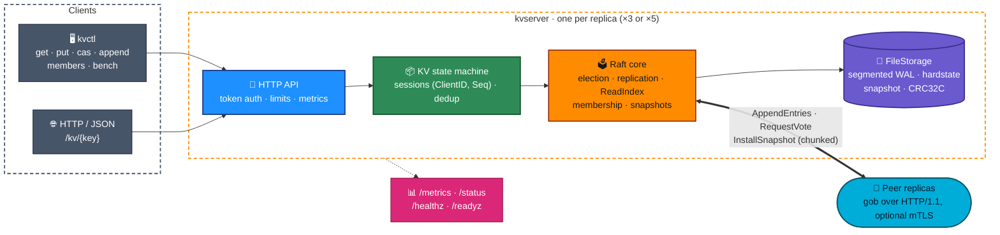
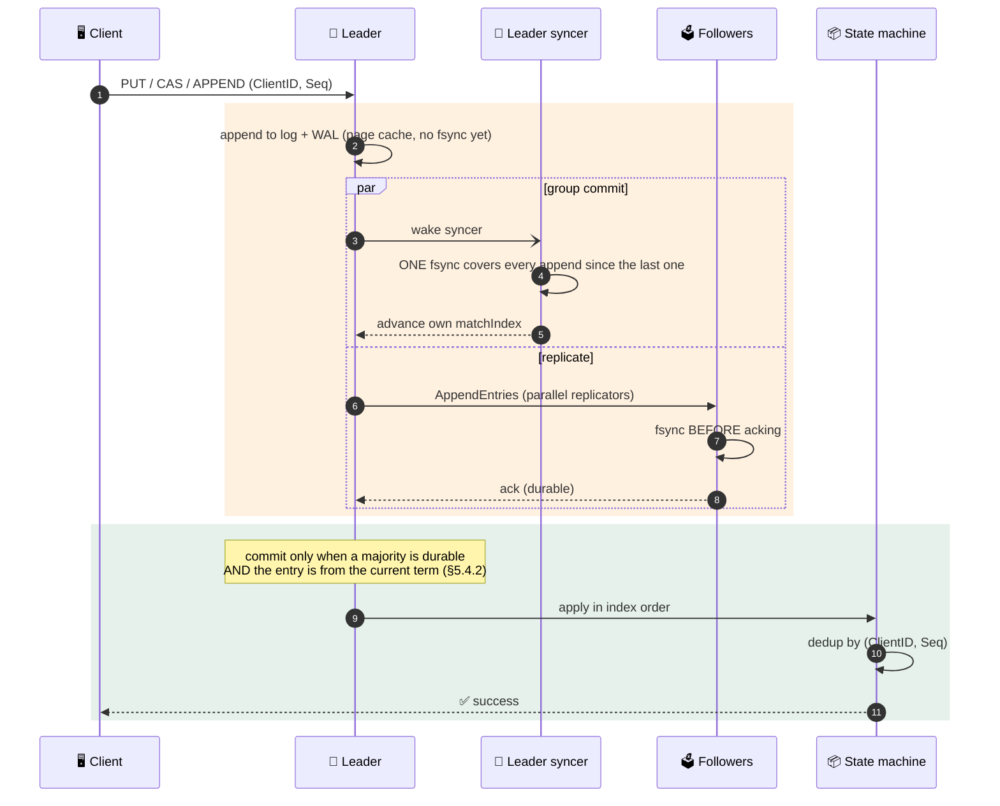
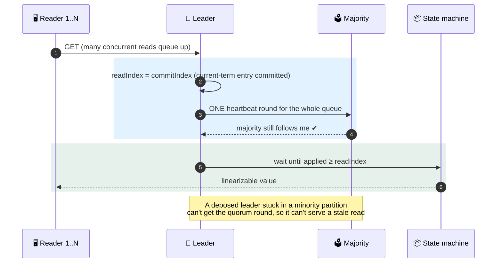
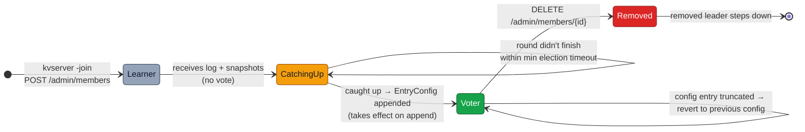
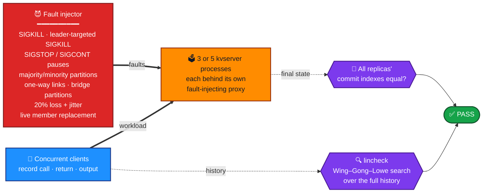
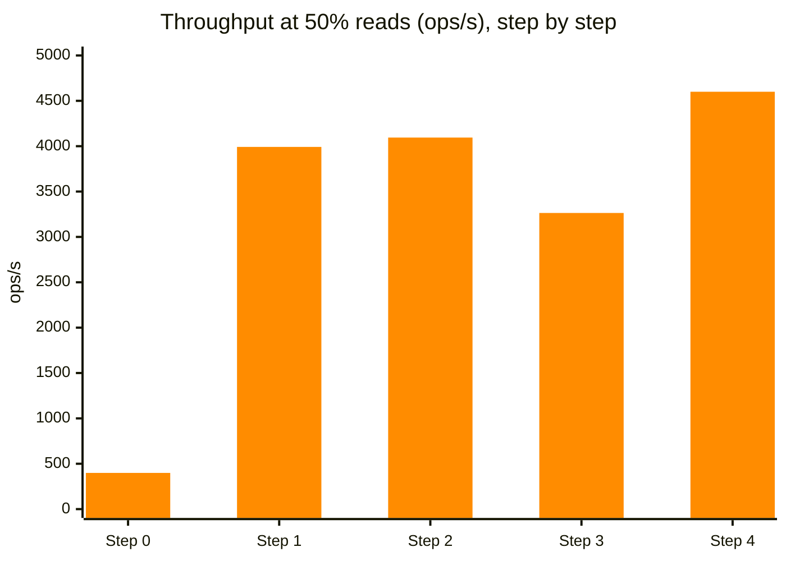

<div align="center">

# 🗳️ Raft KV

### A fault-tolerant, linearizable distributed key-value store built from scratch in Go

**Raft consensus · single-server membership changes · ReadIndex reads · exactly-once sessions · WAL + chunked snapshots · real-process chaos testing**

<br/>


[](https://github.com/siddhaantxsingh/RAFT-KV/actions/workflows/raft-kv-ci.yml)


-7c3aed?style=flat-square)


[**Architecture**](#-architecture) · [**Write & read paths**](#%EF%B8%8F-the-write-path-group-commit) · [**Membership**](#-membership-changes) · [**Chaos testing**](#-chaos-testing-with-real-processes) · [**Bugs found**](#-bugs-found-and-fixed) · [**Performance**](#-performance) · [**Run it**](#-quick-start)

</div>

---

## 📌 TL;DR

> **The contract:** a write that returns success has been replicated by Raft, committed by a quorum, durably fsynced and applied. It survives every failure the system claims to tolerate, **and every claim is checked by a linearizability checker against real client histories.**

| | |
|---|---|
| 🧠 **Consensus** | Raft from the paper: elections with **pre-vote**, log replication with fast conflict backup, current-term commit rule + leader no-op, invariant monitor in every test |
| 👥 **Membership** | **Single-server changes** (Raft thesis §4): learners catch up before promotion, configs take effect on append, a removed leader steps down. Live `kvctl members add/remove` |
| 📖 **Reads** | **Batched ReadIndex**: one heartbeat round confirms leadership for every queued read, so stale reads are impossible after a partition |
| 🔁 **Exactly-once** | `(ClientID, Seq)` sessions with bounded, deterministic eviction. Expired sessions are rejected, never re-applied |
| 💾 **Durability** | Segmented WAL with **group commit**, CRC-framed state files, **chunked + resumable + verified** snapshots, crash-safe two-phase compaction |
| 💥 **Verified by** | 71 tests under `-race`, simulated disk faults (EIO, short writes, torn and reordered tails), and **real-process chaos**: SIGKILL, SIGSTOP, partitions, one-way links, bridges, 20% packet loss, membership churn |
| 🔐 **Hardening** | Opt-in TLS, **mTLS between replicas**, bearer tokens, body and key/value limits, timeouts |

---

## 🏗️ Architecture



<details>
<summary><b>📦 Package map</b></summary>

<br/>

| Package | What's inside |
|---|---|
| [`raft/`](raft-kv/raft) | `raft.go` (consensus core) · `membership.go` (single-server changes) · `storage.go` (WAL, snapshots, compaction) · `network.go` (simulated unreliable network for tests) · `http_transport.go` |
| [`kv/`](raft-kv/kv) | `server.go` (state machine, sessions, ReadIndex) · `client.go` (retrying client) · `http.go` (REST API) · `lsmstore/` (optional Rust LSM backend via C ABI) |
| [`lincheck/`](raft-kv/lincheck) | **Wing–Gong–Lowe linearizability checker**, partitioned by key |
| [`secure/`](raft-kv/secure) | TLS / mTLS config, bearer-token middleware, request limits, test PKI |
| [`cmd/kvserver`](raft-kv/cmd/kvserver) | Server binary + `/admin/members` API |
| [`cmd/kvctl`](raft-kv/cmd/kvctl) | CLI + closed-loop benchmark |
| [`cmd/kvchaos`](raft-kv/cmd/kvchaos) | **Real-process chaos harness** with fault-injecting proxies + failover timer |

</details>

---

## ✍️ The write path (group commit)



## 📖 The read path (batched ReadIndex)



> **Why batch?** My first ReadIndex ran one heartbeat round *per read* and was **slower** than putting reads through the log (2.7k vs 4.2k ops/s), because it gave up batching. One shared round per queue gave **9,250 ops/s** on a 99%-read workload.

---

## 👥 Membership changes

Single-server changes following the Raft thesis §4.1–4.3, including the 2015 raft-dev correction (no change until the leader has committed an entry in its term). Design write-up: [ADR 0006](raft-kv/docs/adr/0006-single-server-membership-changes.md).



**Tested by** 9 membership tests (including churn under partitions and a leader crash mid-change), admin API tests, live kvchaos runs that replace members while the workload runs, and **mutation testing: 10 mutants, 9 killed, 1 equivalent.**

---

## 💥 Chaos testing with real processes

`kvchaos` launches real `kvserver` processes, puts a **fault-injecting HTTP proxy in front of each one**, runs a concurrent client workload, records the full history, then **checks it for linearizability and that all replicas converged.**



### Recorded runs (evidence: [`docs/evidence/2026-10-14/`](raft-kv/docs/evidence/2026-10-14) · [`docs/results/`](raft-kv/docs/results))

| Run | Nodes | Faults | Duration | Ops | Kills | Partitions | Member swaps | Linearizable | Converged |
|---|:---:|---|:---:|---:|:---:|:---:|:---:|:---:|:---:|
| `chaos-all-5node-seed3` | 5 | **everything** | 62 s | 24,639 | 2 | 3 | 5 | ✅ | ✅ |
| `chaos-all-5node-seed4` | 5 | **everything** | 60 s | 27,398 | 3 | 3 | 3 | ✅ | ✅ |
| `chaos-net-5node-seed1` | 5 | partition, one-way, bridge, loss | 60 s | 12,007 | 0 | 2 + 5 + 5 | 0 | ✅ | ✅ |
| `chaos-net-5node-seed2` | 5 | partition, one-way, bridge, loss | 63 s | 26,443 | 0 | 3 | 0 | ✅ | ✅ |
| `chaos-membership-3node-seed5` | 3 | membership, partition, kill | 61 s | 28,037 | 9 | 6 | 6 | ✅ | ✅ |
| `chaos-baseline-faults-3node-seed7` | 3 | kill, pause | 31 s | 16,826 | 6 | 0 | 0 | ✅ | ✅ |
| `chaos-seed-random` | 3 | kill, pause | 41 s | 76,586 | 8 | 0 | 0 | ✅ | ✅ |
| `chaos-lsm-seed-7` (Rust LSM store) | 3 | kill, pause | 41 s | 65,170 | 10 | 0 | 0 | ✅ | ✅ |

<sub>"everything" = kill, pause, partition, one-way, bridge, loss and membership. CI runs a 3-node kill/pause run and a 5-node all-faults run on every push.</sub>

### ⏱️ 5-node leader failover (SIGKILL the leader, 45 trials)

| | p50 | p90 | max |
|---|:---:|:---:|:---:|
| New leader elected | **356 ms** | 530 ms | 751 ms |
| First committed write | **418 ms** | 541 ms | **757 ms** |

Election timeout is 300–600 ms. **45/45** trials committed a write within 2× the max timeout (1,200 ms) and 44/45 within 2× the min (600 ms). All on one shared 4-vCPU machine over localhost.

---

## 🧪 Testing the tester

A green test suite means nothing if the checker can't fail. So:

- 🧨 **Negative control:** `TestCheckerCatchesStaleReads` turns on an *unsafe* read path and proves the linearizability checker **rejects** the resulting history.
- 👁️ **Invariant monitor:** samples every peer every **2 ms** in every harness test for election safety and commit monotonicity. A log conflict at or below `commitIndex` **panics** instead of rewriting history.
- 📼 **Apply recorder:** fails the test if two peers ever apply different commands at the same index.
- 🧬 **Mutation testing** on membership: 9 of 10 mutants killed. The survivor is provably equivalent, because a second guard already stops learners from campaigning.
- 💽 **Simulated disk faults:** fsync EIO, short writes, and crashes that keep a cut, torn or **out-of-order** part of the unsynced WAL tail.

| Raft safety property (§5) | Enforced by | Checked by |
|---|---|---|
| **Election Safety** | majority votes, term persisted before replying, pre-vote | invariant monitor · `TestManyElections` |
| **Log Matching** | prevLogIndex/Term check, truncate only on a real conflict | `TestBackup` · `TestFigure8Unreliable` |
| **Leader Completeness** | election restriction + current-term commit + no-op | Figure-8 stress |
| **State Machine Safety** | apply committed entries in order | apply recorder + lincheck |
| **Linearizable reads** | ReadIndex quorum round | `TestCheckerCatchesStaleReads` · `TestKVNoMinorityProgress` |
| **Exactly-once writes** | bounded session table, `ErrSessionExpired` | `kv/session_test.go` |

---

## 🐞 Bugs found and fixed

Each fix landed with a test that **failed first**:

| ID | Severity | Bug | Failing-first evidence |
|:---:|:---:|---|---|
| R-H1 | 🔴 High | **Mid-WAL corruption silently truncated acknowledged entries.** One flipped byte → `Load` returned no error, kept 10 of 50 entries, and shrank the file from 3,260 to 652 B | `TestFileStorageMidWALCorruptionFailsLoad` |
| A1 | 🔴 High | After a **short write (ENOSPC)** the WAL kept accepting appends behind the partial record, so acknowledged entries became unrecoverable | `TestDiskFaultShortWriteIsStickyAndRecoverable` |
| A2 | 🔴 High | **"fsyncgate":** a retried `Sync` could succeed after the kernel had dropped the dirty pages | `TestDiskFaultFsyncFailureIsStickyAndReported` |
| R-H2 | 🔴 High | A snapshot too big for one 600 ms RPC could **never** reach a lagging follower | `TestInstallSnapshotChunksResumeAndVerify` |
| R-M1 | 🟠 Med | A delayed AppendEntries moved a follower's **commitIndex backwards** (10 → 3) | `TestCommitIndexNeverDecreases` |
| R-M2 | 🟠 Med | Snapshot disk I/O held the Raft lock, so heartbeats and votes stalled | `TestSnapshotWriteDoesNotHoldRaftLock` |
| R-M3 | 🟠 Med | fsync raced segment rotation → "file already closed" | `TestFileStorageSyncConcurrentWithSnapshot` |

Full write-ups: [`AUDIT_2026-10-14.md`](raft-kv/docs/AUDIT_2026-10-14.md) · [`RAFT_CORRECTNESS.md`](raft-kv/docs/RAFT_CORRECTNESS.md) · [`COMBINED_ARCHITECTURE_AUDIT.md`](raft-kv/docs/COMBINED_ARCHITECTURE_AUDIT.md)

---

## 📈 Performance

### The optimisation journey

Same setup throughout: 3 replicas + load generator on one 2-vCPU VM, 32 closed-loop clients, 64 B values, **real fsync per commit**.



| Step | Change | 50% reads | 99% reads | Lesson |
|:---:|---|---:|---:|---|
| 0 | gob-encode the **whole log** + fsync per write | 399 | — | profile the persist path first |
| 1 | Incremental WAL + **group commit** | 3,992 | — | **10×**, but max latency was 1.03 s… |
| 2 | Fix a waiter-registration race | 4,095 | 4,226 | …max latency 1.03 s → 85 ms: **max latency finds bugs averages hide** |
| 3 | ReadIndex, one round per read | 3,264 | 2,718 | an "optimisation" that gives up batching is slower |
| 4 | **Batched** ReadIndex | 4,600 | **9,250** | **2.2×** on read-heavy load |

### Current code (same VM, interleaved runs)

| Read ratio | In-memory store | Rust LSM store | p99 (memory / LSM) |
|---|---:|---:|---:|
| 90% | 5,438 – 5,608 ops/s | 4,974 – 5,328 ops/s | 14.0–15.3 / 14.5–17.2 ms |
| 50% | 3,848 – 4,040 ops/s | 3,352 – 3,434 ops/s | 18.6–19.6 / 22.5–24.3 ms |

The LSM path costs about 7–13% because every applied write is a cgo call plus an LSM write batch. **The Raft log is the WAL of record**, so the LSM writes without fsync and the fsync budget doesn't change ([ADR 0001](raft-kv/docs/adr/0001-raft-log-is-the-wal-of-record.md), [integration notes](raft-kv/docs/RAFT_LSM_INTEGRATION.md)). Methodology: [`PERFORMANCE.md`](raft-kv/docs/PERFORMANCE.md)

---

## 🚀 Quick start

**Requirements:** Go (latest stable recommended; see [Security](#-security--hardening)). No third-party Go dependencies.

```bash
cd raft-kv
make build                 # → bin/kvserver, bin/kvctl, bin/kvchaos
make test                  # go test -race -count=1 ./...
make cluster               # 3 replicas on :7000-7002, data in ./data
```

```bash
./bin/kvctl put hello world
./bin/kvctl get hello
./bin/kvctl cas hello world raft
./bin/kvctl append hello !
./bin/kvctl members list
./bin/kvctl bench -clients 32 -duration 10s -read-ratio 0.9
```

<details>
<summary><b>💥 Chaos and failover</b></summary>

<br/>

```bash
# 3 processes, kill + pause
./bin/kvchaos -nodes 3 -duration 20s -seed 1 -faults kill,pause

# 5 processes behind fault proxies, every fault type plus membership churn
./bin/kvchaos -nodes 5 -duration 30s -seed 2 -base-port 7300 \
  -faults kill,partition,oneway,bridge,loss,membership
```

</details>

<details>
<summary><b>🌐 HTTP API</b></summary>

<br/>

| Method | Path | Effect |
|---|---|---|
| `GET` | `/kv/{key}` | Linearizable read → `{"value": "...", "found": true}` |
| `PUT` | `/kv/{key}` (body = value) | Insert / replace |
| `POST` | `/kv/{key}?op=append` | Append, returns the new value |
| `POST` | `/kv/{key}?op=cas` (body `{"expected","value"}`) | Compare-and-swap |
| `DELETE` | `/kv/{key}` | Remove |
| `GET` / `POST` / `DELETE` | `/admin/members[/{id}]` | List / add / remove a member |
| `GET` | `/status` · `/metrics` · `/healthz` · `/readyz` | Observability |

</details>

<details>
<summary><b>🐳 Docker</b></summary>

<br/>

```bash
cd raft-kv
docker compose up -d                       # 3 replicas
docker compose exec n0 kvctl -s http://n0:7000,http://n1:7000,http://n2:7000 put hello world
docker compose stop n1                     # kill a replica; the cluster keeps serving
```

</details>

---

## 🔐 Security & hardening

- **Transport:** opt-in TLS, **mutual TLS between replicas**, certificate validation ([ADR 0004](raft-kv/docs/adr/0004-transport-security.md))
- **Clients:** bearer-token auth on `/kv/` and `/admin/`, body and key/value size limits, timeouts
- **Storage:** CRC32C on WAL records and on hardstate/snapshot files; corruption fails loudly instead of truncating
- **Supply chain:** `staticcheck` and `govulncheck` run in CI on the latest stable Go. With go1.24.7, govulncheck found 37 reachable stdlib vulnerabilities, so CI and the Dockerfile now track the latest stable release

Security is opt-in. ACLs and credential rotation are not implemented. Details: [`SECURITY.md`](raft-kv/docs/SECURITY.md)

---

## 🧭 Design decisions

| ADR | Decision |
|---|---|
| [0001](raft-kv/docs/adr/0001-raft-log-is-the-wal-of-record.md) | The Raft log is the WAL of record; the state store doesn't need its own fsync |
| [0002](raft-kv/docs/adr/0002-chunked-snapshots-and-two-phase-compaction.md) | Chunked snapshots + two-phase compaction (crash-safe at every point) |
| [0003](raft-kv/docs/adr/0003-bounded-deterministic-sessions.md) | Bounded, deterministic session eviction for exactly-once semantics |
| [0004](raft-kv/docs/adr/0004-transport-security.md) | TLS / mTLS / token transport security |
| [0006](raft-kv/docs/adr/0006-single-server-membership-changes.md) | Single-server membership changes instead of joint consensus (supersedes 0005: static membership) |

Deep dive: [`DESIGN.md`](raft-kv/DESIGN.md) · Interview walkthrough: [`INTERVIEW.md`](raft-kv/docs/INTERVIEW.md)

---

## ⚠️ Limitations

Every claim above links to a log. What this project does **not** claim:

- **No joint consensus or leadership transfer.** Membership uses single-server changes.
- **Single Raft group.** No sharding, so throughput is bounded by one leader.
- **Single-machine evidence only.** All benchmarks and failover numbers are over localhost.
- **Disk faults are simulated.** No real failing hardware or power-loss testing. Out-of-order write-back can force manual recovery (seen in 1 of 100 simulated crashes, with no acknowledged data lost).
- **The process-level stale-read negative control didn't fire in a 40 s run.** The in-process control does catch it; the chaos workload rarely reads from a deposed leader.
- **Peer RPC is gob over HTTP/1.1, not gRPC.**
- **The Rust LSM store isn't reproducible yet:** its C-ABI crate (`lsm-capi`) isn't published, so `-tags lsm` can't be built from public sources.
- **No backup/restore tooling.**

---

## 📁 Repository layout

```text
RAFT-KV/
├── .github/workflows/raft-kv-ci.yml   ⚙️  fmt · vet · staticcheck · govulncheck · race tests · 2 chaos runs · docker smoke
└── raft-kv/
    ├── raft/          🗳️  consensus, membership, storage, transport (+ fault tests)
    ├── kv/            📦  state machine, sessions, HTTP API, client, lsmstore/
    ├── lincheck/      🔍  linearizability checker
    ├── secure/        🔐  TLS / mTLS / auth / limits
    ├── cmd/           🛠️  kvserver · kvctl · kvchaos
    ├── scripts/       📜  cluster.sh · chaos.sh
    ├── docs/          📖  correctness, performance, security, ADRs, audits, evidence logs
    ├── DESIGN.md      🧠  full design write-up
    └── Dockerfile · docker-compose.yml
```

---

<div align="center">

### The interesting part of Raft isn't electing a leader.
### It's keeping the system's promises when the world stops cooperating.

<br/>

Built by **[Siddhant Singh](https://github.com/siddhaantxsingh)** · <sub>MIT License</sub>

</div>
