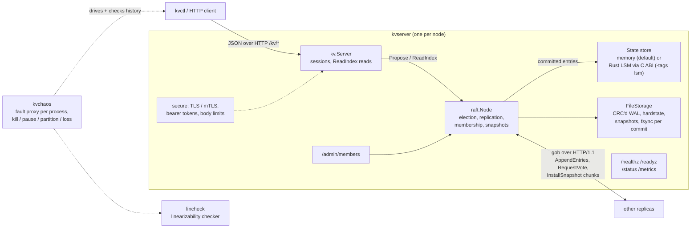

# Raft KV

A Raft-replicated, linearizable key-value store in Go, with membership changes, chaos testing on real processes, and a custom linearizability checker.

[](https://github.com/siddhaantxsingh/RAFT-KV/actions/workflows/raft-kv-ci.yml?query=branch%3Accr-a6e6c567-y4w7k8)

[](raft-kv/LICENSE)

Consensus, the write-ahead log, snapshots, linearizable reads, exactly-once retries and the test harness are written from scratch. No Raft library is used.

## Highlights

- **Raft with pre-vote, fast log backup and chunked snapshots.** 71 test functions pass under `go test -race`, with an invariant monitor checking election safety, log matching and the commit rule ([test log](raft-kv/docs/evidence/2026-10-14/test-race-final.log)).
- **Linearizable reads and writes.** Reads use ReadIndex; retries use bounded client sessions for exactly-once writes. Every chaos run is checked by the in-repo linearizability checker ([`lincheck/`](raft-kv/lincheck)).
- **Fault injection on real processes.** 7/7 recorded `kvchaos` runs on 3 and 5 `kvserver` processes (SIGKILL, SIGSTOP, majority/minority, one-way and bridge partitions, packet loss, member replacement; 30–63 s, 12k–28k operations each) were linearizable and converged ([evidence](raft-kv/docs/evidence/2026-10-14/)).
- **Single-server membership changes.** Learners catch up before promotion; config changes are tested under partitions and leader crashes. 9 of 10 membership mutants were killed by the tests; the 10th is equivalent ([ADR 0006](raft-kv/docs/adr/0006-single-server-membership-changes.md)).
- **5-node leader failover.** Over 45 SIGKILL-the-leader trials, the first committed write came back after p50 ≈ 380 ms, max 757 ms; 45/45 within 2x the maximum election timeout (1,200 ms). One shared 4-vCPU machine, localhost network.
- **Simulated disk faults.** fsync EIO, short writes, and crashes that keep a cut, torn or reordered unsynced WAL tail. Two WAL bugs were found and fixed with failing-first tests ([audit](raft-kv/docs/AUDIT_2026-10-14.md)).

## Architecture



Each node runs one `kvserver` process (`cmd/kvserver`). A client request reaches `kv.Server` (`kv/`), which proposes writes to the Raft node (`raft/raft.go`) and serves reads only after a ReadIndex quorum check and after the state machine has applied up to that index. Raft persists its log, hard state and snapshots in `FileStorage` (`raft/storage.go`) with checksums and one fsync per commit (group commit batches concurrent proposals). Committed entries are applied to the state store; with the optional LSM store the Raft log stays the WAL of record and the store writes without fsync ([ADR 0001](raft-kv/docs/adr/0001-raft-log-is-the-wal-of-record.md)). Peers talk gob-encoded HTTP/1.1 (`raft/http_transport.go`), not gRPC. `kvchaos` (`cmd/kvchaos`) starts real processes behind fault-injecting proxies, records every client operation, and feeds the history to `lincheck`.

## Quick start

Requires Go 1.24+ (use the latest patched release; see [Limitations](#limitations-and-status)).

```bash
git clone https://github.com/siddhaantxsingh/RAFT-KV.git
cd RAFT-KV/raft-kv

make build        # bin/kvserver, bin/kvctl, bin/kvchaos
make test         # go test -race -count=1 ./...
```

Run a local 3-node cluster (ports 7000–7002, data in `./data`) and talk to it:

```bash
make cluster
./bin/kvctl put hello world
./bin/kvctl get hello
./bin/kvctl cas hello world raft
./bin/kvctl members list
make bench        # 32 clients, 10 s, 90 % reads
make clean        # stop the cluster and remove bin/ and data/
```

Run the same chaos tests as CI:

```bash
./bin/kvchaos -nodes 3 -duration 20s -seed 1 -faults kill,pause
./bin/kvchaos -nodes 5 -duration 30s -seed 2 -base-port 7300 \
  -faults kill,partition,oneway,bridge,loss,membership
./bin/kvchaos -nodes 5 -failover-trials 15   # leader-kill recovery timing
```

Docker (single node smoke test, as in CI):

```bash
docker build -t raftkv .
docker run -d -p 17000:7000 raftkv -id 0 -peers http://127.0.0.1:7000
curl -X PUT --data world http://127.0.0.1:17000/kv/hello
curl http://127.0.0.1:17000/kv/hello
```

## Results

### Fault injection (audit 2026-10-14, shared 4-vCPU container)

| Run | Processes | Faults | Duration | Ops | Result |
|---|---:|---|---:|---:|---|
| `chaos-baseline-faults-3node-seed7` | 3 | kill, pause | 31 s | 16,826 | linearizable, converged |
| `chaos-membership-3node-seed5` | 3 | membership, partition, kill | 61 s | 28,037 | linearizable, converged |
| `chaos-net-5node-seed1` | 5 | partition, one-way, bridge, loss | 60 s | 12,007 | linearizable, converged |
| `chaos-net-5node-seed2` | 5 | partition, one-way, bridge, loss | 63 s | 26,443 | linearizable, converged |
| `chaos-all-5node-seed3` | 5 | all of the above + membership | 62 s | 24,639 | linearizable, converged |
| `chaos-all-5node-seed4` | 5 | all of the above + membership | 60 s | 27,398 | linearizable, converged |

JSON summaries and logs: [`docs/evidence/2026-10-14/`](raft-kv/docs/evidence/2026-10-14/). The baseline 3-process run (`baseline-chaos-seed1`, 17,915 ops) is the 7th passing run.

### 5-node failover (45 trials, election timeout 300–600 ms)

| Metric | p50 | Max |
|---|---:|---:|
| New leader elected | ≈ 360 ms | 751 ms |
| First committed write | ≈ 380 ms | 757 ms |

44/45 trials under 600 ms (2x min timeout), 45/45 under 1,200 ms (2x max). Single machine under load average 12–25; not a multi-machine number. Evidence: `failover-5node-run{1,2,3}.json`.

### Throughput (3 replicas + load generator on one 2-vCPU VM)

32 closed-loop clients, 1,000 keys, 64-byte values, real fsync per commit, 3 runs each:

| Read ratio | Memory store | LSM store (`-store lsm`) |
|---|---|---|
| 90 % | 5,438–5,608 ops/s, p99 14.0–15.3 ms | 4,974–5,328 ops/s, p99 14.5–17.2 ms |
| 50 % | 3,848–4,040 ops/s, p99 18.6–19.6 ms | 3,352–3,434 ops/s, p99 22.5–24.3 ms |

These numbers are from a localhost VM and are not comparable across machines: the same commands on the shared 4-vCPU audit container at load average 22–31 gave 2,639–3,284 ops/s (90 % reads) and 2,065–2,466 ops/s (50 % reads). Full method and raw outputs: [PERFORMANCE.md](raft-kv/docs/PERFORMANCE.md), [`docs/results/bench/`](raft-kv/docs/results/bench/).

## How correctness is verified

| Layer | What runs | Where |
|---|---|---|
| Raft safety | Election, replication, Figure-8 style stress, unreliable network, crash/restart, with an invariant monitor | [`raft/raft_test.go`](raft-kv/raft/raft_test.go) |
| Linearizability | Wing & Gong search with Lowe's memoisation, partitioned per key; a negative test makes reads unsafe and checks the checker rejects the history | [`lincheck/`](raft-kv/lincheck), `TestCheckerCatchesStaleReads` |
| Storage | Torn tail, CRC failures, mid-WAL corruption, snapshot/close races | [`raft/storage_test.go`](raft-kv/raft/storage_test.go), [`raft/snapshot_test.go`](raft-kv/raft/snapshot_test.go) |
| Disk faults | fsync EIO, short write, 100 simulated crashes with torn/cut/reordered tails | [`raft/diskfault_test.go`](raft-kv/raft/diskfault_test.go) |
| Membership | 9 tests incl. churn under partitions and leader crash mid-change; mutation testing (9/10 killed) | [`raft/membership_test.go`](raft-kv/raft/membership_test.go) |
| Security | 3-replica mTLS + token cluster end to end; oversized values rejected, not truncated | [`secure/secure_test.go`](raft-kv/secure/secure_test.go) |
| Process chaos | `kvchaos` runs above | [`cmd/kvchaos/`](raft-kv/cmd/kvchaos) |
| CI | gofmt, vet, staticcheck, govulncheck, race tests, two chaos runs, Docker smoke test | [`raft-kv-ci.yml`](.github/workflows/raft-kv-ci.yml) |

More detail: [RAFT_CORRECTNESS.md](raft-kv/docs/RAFT_CORRECTNESS.md), [REQUIREMENTS_MATRIX.md](raft-kv/docs/REQUIREMENTS_MATRIX.md).

## Design decisions

- **The Raft log is the WAL of record.** The LSM store applies each entry as one atomic batch without fsync and replays from the Raft log after a crash, so a write costs one fsync, not two ([ADR 0001](raft-kv/docs/adr/0001-raft-log-is-the-wal-of-record.md)).
- **Two-phase snapshot save, then compaction.** The snapshot file is saved first; the log is then compacted into a new fsynced WAL segment. The stored log always covers what the snapshot does not, so a crash at any point is safe. Followers receive CRC-checked, resumable chunks ([ADR 0002](raft-kv/docs/adr/0002-chunked-snapshots-and-two-phase-compaction.md)).
- **Bounded, deterministic sessions.** The session table holds at most 100k sessions with deterministic eviction on every replica; anonymous requests keep no state ([ADR 0003](raft-kv/docs/adr/0003-bounded-deterministic-sessions.md)).
- **Security is opt-in.** mTLS and separate peer/client bearer tokens are available but off by default to keep the quick start simple ([ADR 0004](raft-kv/docs/adr/0004-transport-security.md), [SECURITY.md](raft-kv/docs/SECURITY.md)).
- **Single-server membership changes, not joint consensus.** Simpler to get right and enough for replacing one node at a time ([ADR 0006](raft-kv/docs/adr/0006-single-server-membership-changes.md), superseding [ADR 0005](raft-kv/docs/adr/0005-static-membership.md)).
- **HTTP RPC instead of gRPC.** Peers use gob over `net/http`; clients use JSON. Fewer dependencies, easy to proxy for fault injection.

## Limitations and status

- **The Rust LSM store is optional.** `-tags lsm` links against the C API of [LSM_ENGINE](https://github.com/siddhaantxsingh/LSM_ENGINE) (`capi/`, `liblsm.a`). CI builds it and runs the LSM-backed tests and a chaos run on every push (see [RAFT_LSM_INTEGRATION.md](raft-kv/docs/RAFT_LSM_INTEGRATION.md)). The LSM throughput numbers above are from earlier runs on a 2-vCPU VM.
- **The process-level negative control did not fire.** A deliberately broken server (`-unsafe-stale-reads-for-testing`) was not caught in a 40 s partition run; the in-process negative test still catches it.
- **Simulated disk faults only.** No real failing hardware or power-loss testing. In 1 of 100 simulated crashes, an out-of-order write-back makes the node refuse to start (no acknowledged data lost, manual recovery needed).
- **Toolchain.** `go.mod` says go1.24.7, which has 37 reachable standard-library vulnerabilities per govulncheck. CI and the Dockerfile use the latest stable Go; build locally with a patched toolchain.
- **Not implemented:** joint consensus, leadership transfer, backup/restore, sharding, multi-machine benchmarks. `kvchaos` does not clean up child processes if it is itself killed.
- **Not production ready.** Auth is off by default and all evidence comes from one machine.

## Repository layout

```text
.github/workflows/raft-kv-ci.yml   CI (runs from the repo root, works in raft-kv/)
raft-kv/
├── raft/        consensus, membership, FileStorage (WAL), HTTP transport, tests
├── kv/          state machine, sessions, ReadIndex reads, client, HTTP API
│   └── lsmstore/  optional Rust LSM store via C ABI (-tags lsm)
├── lincheck/    linearizability checker
├── secure/      TLS / mTLS, bearer tokens, request limits
├── cmd/
│   ├── kvserver/  replica binary, admin API, metrics
│   ├── kvctl/     CLI and load generator
│   └── kvchaos/   process chaos, network fault proxy, failover timing
├── scripts/     local cluster and chaos helpers
└── docs/        design docs, ADRs, results, evidence
```

## Documentation

| Topic | Link |
|---|---|
| Design notes (why it is built this way) | [DESIGN.md](raft-kv/DESIGN.md) |
| Raft correctness | [RAFT_CORRECTNESS.md](raft-kv/docs/RAFT_CORRECTNESS.md) |
| Distributed storage | [DISTRIBUTED_STORAGE.md](raft-kv/docs/DISTRIBUTED_STORAGE.md) |
| Raft + LSM integration | [RAFT_LSM_INTEGRATION.md](raft-kv/docs/RAFT_LSM_INTEGRATION.md) |
| Performance | [PERFORMANCE.md](raft-kv/docs/PERFORMANCE.md), [BASELINE.md](raft-kv/docs/BASELINE.md) |
| Security | [SECURITY.md](raft-kv/docs/SECURITY.md) |
| Requirements matrix | [REQUIREMENTS_MATRIX.md](raft-kv/docs/REQUIREMENTS_MATRIX.md) |
| Audit and scorecard (2026-10-14) | [AUDIT_2026-10-14.md](raft-kv/docs/AUDIT_2026-10-14.md) |
| Owner actions | [OWNER_ACTIONS.md](raft-kv/docs/OWNER_ACTIONS.md) |
| ADRs | [`docs/adr/`](raft-kv/docs/adr/) |

---

Built by [Siddhant Singh](https://github.com/siddhaantxsingh). Licensed under the [MIT License](raft-kv/LICENSE).
